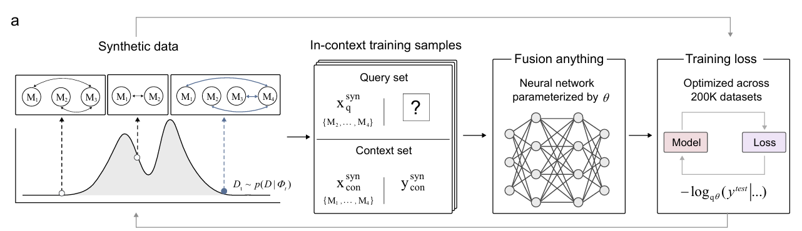
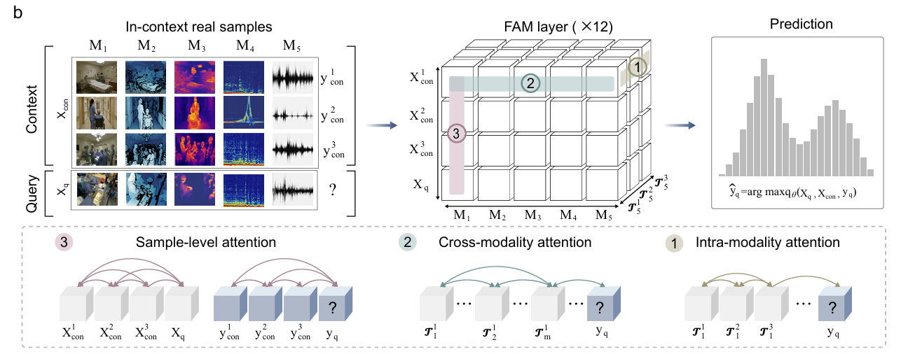

<p align="center">
  
</p>

<h2 align="center">Fusion Anything: A Generalized Multimodal Foundation Model</h2>

<p align="center">
  Huizi Cui<sup>1,&dagger;</sup>, Zongbo Han<sup>2,&dagger;,&ddagger;</sup>, Chenggong Ding<sup>1</sup>, Naichuan Xiao<sup>1</sup>, Jialong Yang<sup>1</sup>, Jingdong Chen<sup>1</sup><br>, Yafei Yang<sup>1</sup>, Guangyu Wang<sup>2</sup>, Qinghua Hu<sup>1</sup>, Changqing Zhang<sup>1,*</sup>
</p>

<p align="center">
  <sup>1</sup> Tianjin University &nbsp;&nbsp; <sup>2</sup> Beijing University of Posts and Telecommunications<br />
  <sub><sup>&dagger;</sup> Equal contribution &nbsp;&middot;&nbsp; <sup>&ddagger;</sup> Project lead &nbsp;&middot;&nbsp; <sup>*</sup> Corresponding author</sub>
</p>

<p align="center">
  <a href="https://arxiv.org/abs/2609.22107"></a>
  <a href="https://huggingface.co/FusionAnything/FAMv1"></a>
  <a href="https://www.python.org/"></a>
  <a href="LICENSE"></a>
</p>

---

## Overview

Making predictions with multimodal data is widely used in diverse scenarios. Existing multimodal fusion models, once deployed, can only handle predefined modalities (e.g., vision, text, and audio) and a single task, making it difficult to quickly adapt to new downstream applications. Therefore, a natural yet ambitious question arises—whether there exists a general multimodal fusion model that can be applied to arbitrary modality combinations and arbitrary prediction tasks. We argue that a unified multimodal fusion model should not depend on specific modalities and should instead encode transferable patterns of multimodal correlation.

To this end, we propose a simple and effective learning paradigm based on training on large-scale synthetic multimodal datasets generated with **Structural Multimodal Causal Models (SMCMs)**, which formally characterize the generative processes of real-world multimodal data. Building on this framework, we propose the **Fusion Anything Model (FAM)**, a foundation model for generalized multimodal data fusion. By constructing large-scale synthetic multimodal data with diverse correlation patterns, FAM encodes transferable multimodal correlations during training and activates appropriate associations through in-context examples during inference—predicting query class probabilities in a **single forward pass** with no task-specific adaptation. Extensive experiments over **20 real-world datasets spanning 11 modalities** demonstrate that FAM achieves competitive performance with specialized models without task-specific adaptation.

<p align="center">
  
  <br />
  
</p>

---

## Installation

> **Requirements:** Linux, Python 3.10+ (tested on Python 3.13), and an **NVIDIA GPU** with CUDA.

```bash
git clone https://github.com/huizi-Cui/Fusion_Anything_Model.git
cd Fusion_Anything_Model

# 1. Install PyTorch with CUDA support (adjust cu128 for your CUDA version)
pip install torch==2.9.0 torchvision==0.24.0 --index-url https://download.pytorch.org/whl/cu128

# 2. Install Fusion Anything
pip install -e .
```

For exact benchmark reproduction, install the pinned environment via `pip install -r requirements.txt && pip install -e . --no-deps`.

---

## Model Weights

Model weights are hosted on Hugging Face rather than inside this repository:

- **Checkpoint:** `FAM.pt` (51 MB)
- **Download:** [FusionAnything/FAMv1](https://huggingface.co/FusionAnything/FAMv1)
- **SHA-256:** `c479255355e66144a7b70195490d243a66a92fcfa85640187d5bb5a02e9d6e33`

Download via `huggingface-cli` (or manually from the repository page) into `checkpoints/`:

```bash
huggingface-cli download FusionAnything/FAMv1 FAM.pt --local-dir checkpoints
```

You can also store the file elsewhere and specify it via `FAM_CHECKPOINT` or the `checkpoint` argument:

```bash
export FAM_CHECKPOINT=/path/to/FAM.pt
```

---

## Quick Start

FAM provides a lightweight `scikit-learn`-style API (`fit` stores the Context set without updating model weights; `predict_proba` / `predict` runs in-context inference):

```python
import numpy as np
from fusion_anything import FusionAnythingClassifier

# Each modality is a 2D float array of shape [n_samples, n_features]
context = {
    "image": np.load("context_image.npy"),
    "tabular": np.load("context_tabular.npy"),
}
labels = np.load("context_labels.npy")  # 1D int array, 0..K-1

query = {
    "image": np.load("test_image.npy"),
    "tabular": np.load("test_tabular.npy"),
}

model = FusionAnythingClassifier(device="cuda:0", preprocessing="pca")
model.fit(context, labels, structured_modalities=["tabular"])

probabilities = model.predict_proba(query)  # shape: [n_query, n_classes]
predictions = model.classes_[probabilities.argmax(axis=1)]
```

You can test the installation immediately with synthetic data:

```bash
python examples/quickstart.py
```

---

## Citation

If you find Fusion Anything useful in your research, please cite our paper:

```bibtex
@article{cui2026fusion,
  title={Fusion Anything: A Generalized Multimodal Foundation Model},
  author={Cui, Huizi and Han, Zongbo and Ding, Chenggong and Xiao, Naichuan and Yang, Jialong and Chen, Jingdong and Wang, Guangyu and Hu, Qinghua and Zhang, Changqing},
  journal={arXiv preprint arXiv:2609.22107},
  year={2026}
}
```

---

## License & Acknowledgments

- The Fusion Anything codebase is licensed under the **[Apache License 2.0](LICENSE)**.
- **Built with PriorLabs-TabPFN** — the bundled TabPFN v2 runtime under `fusion_anything/vendor/tabpfn_runtime/` is subject to the [Prior Labs License](fusion_anything/vendor/tabpfn_runtime/LICENSE).

---

## Contact

- **Huizi Cui** ([huizicui@tju.edu.cn](mailto:huizicui@tju.edu.cn)) — Data generation & FAM training
- **Chenggong Ding** ([chenggong_ding@tju.edu.cn](mailto:chenggong_ding@tju.edu.cn)) — FAM evaluation
- **Naichuan Xiao** ([xiaonaichuan@tju.edu.cn](mailto:xiaonaichuan@tju.edu.cn)) — Specialized model evaluation
